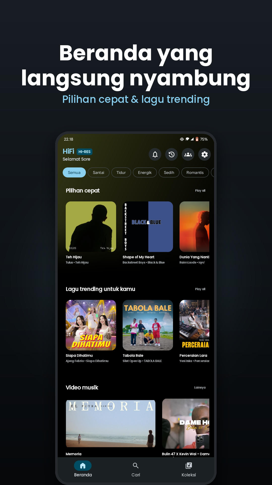
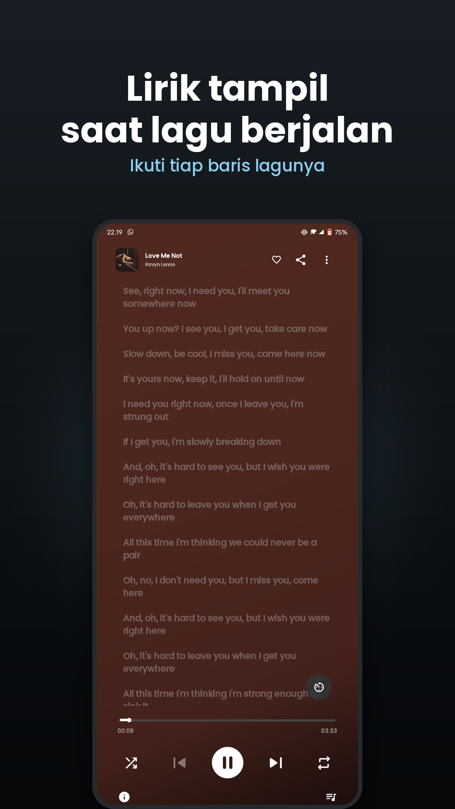
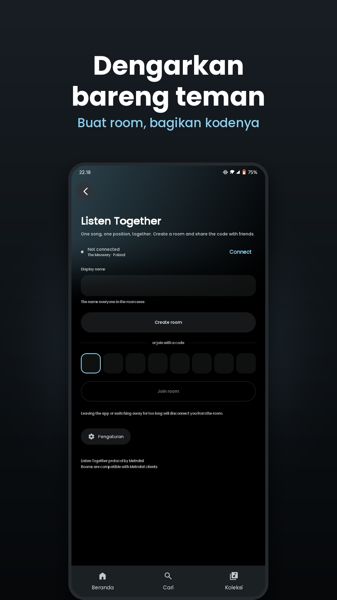
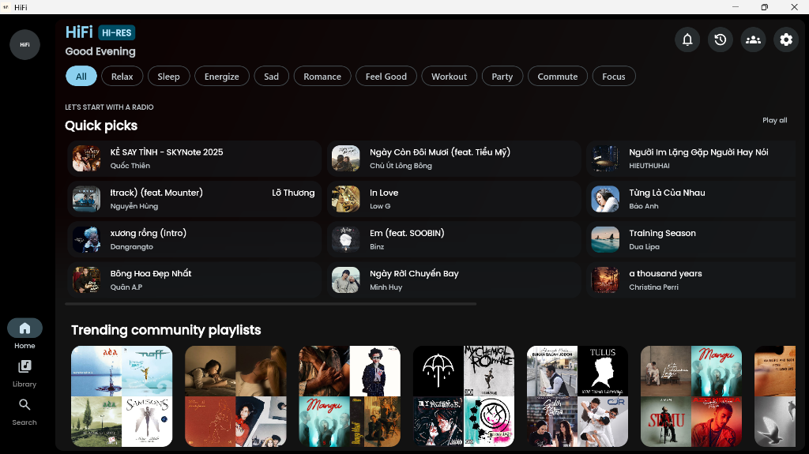
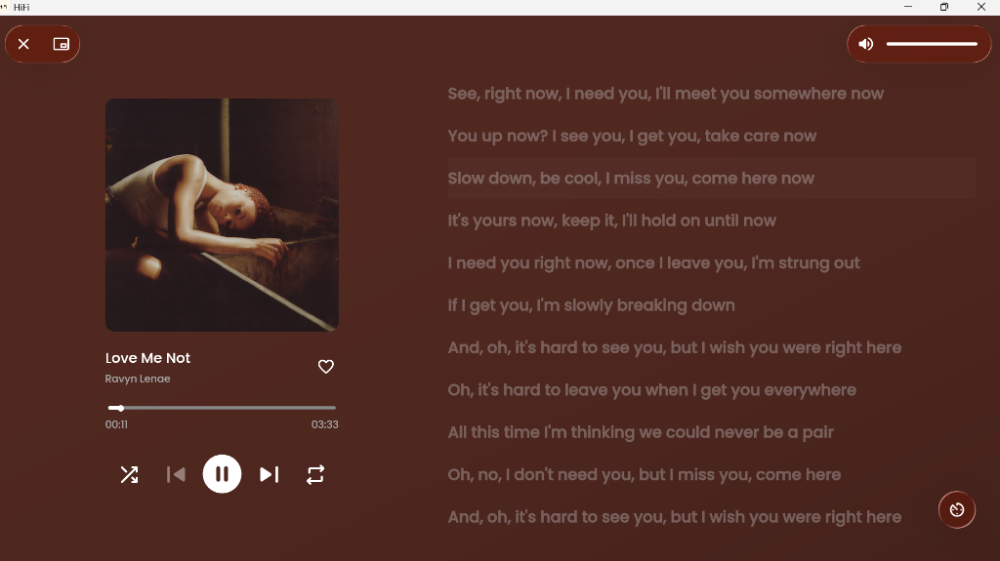
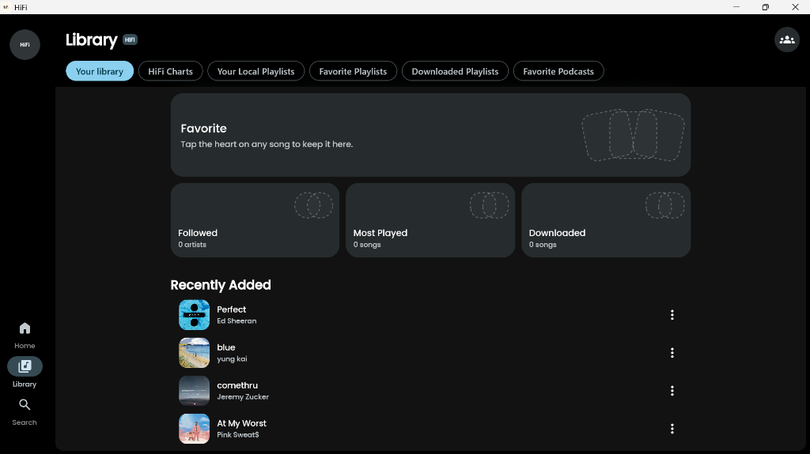
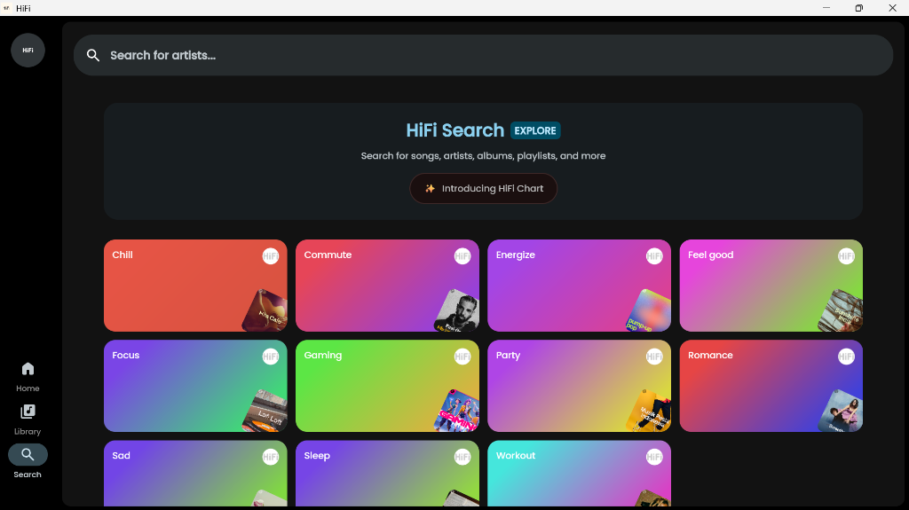

<p align="center">
  
</p>

<p align="center">
  
  <br>
  <strong>Hi-Res Audio Streaming & Player for Android and Desktop</strong>
</p>

<p align="center">
  <a href="https://github.com/saferill/HiFi/releases/latest"></a>
  <a href="LICENSE"></a>
  <a href="https://kotlinlang.org"></a>
  <a href="https://www.jetbrains.com/lp/compose-multiplatform/"></a>
  <a href="https://syafril.pages.dev"></a>
</p>

---

HiFi is an open-source, privacy-respecting music streaming application and local player built with **Kotlin Multiplatform** and **Compose Multiplatform**. It connects directly to public music streaming sources to provide an ad-free, high-fidelity audio experience with real-time synchronized lyrics, offline caching, and Material You dynamic theming.

## Downloads

Download the latest prebuilt binaries from the [Releases](https://github.com/saferill/HiFi/releases/latest) page:

| Platform | Package | Architecture | Description |
| :--- | :--- | :--- | :--- |
| **Windows** | [`HiFi-2.3.0-Setup.exe`](https://github.com/saferill/HiFi/releases/latest/download/HiFi-2.3.0-Setup.exe) | x64 | Official Inno Setup installer with start menu & desktop shortcuts |
| **Android** | [`HiFi-arm64-v8a.apk`](https://github.com/saferill/HiFi/releases/latest/download/androidApp-arm64-v8a-release.apk) | ARM64 | Recommended for modern Android phones and tablets |
| **Android** | [`HiFi-universal.apk`](https://github.com/saferill/HiFi/releases/latest/download/androidApp-universal-release.apk) | All | Universal APK compatible with all Android devices |
| **Android** | [`HiFi-armeabi-v7a.apk`](https://github.com/saferill/HiFi/releases/latest/download/androidApp-armeabi-v7a-release.apk) | ARMv7 | Legacy 32-bit Android devices |
| **Android** | [`HiFi-x86_64.apk`](https://github.com/saferill/HiFi/releases/latest/download/androidApp-x86_64-release.apk) | x86_64 | Android emulators & ChromeOS |

## Screenshots

### Mobile Experience
<p align="center">
  
  
  
  
</p>
<p align="center">
  
  
  
</p>

### Desktop Experience
<p align="center">
  
  
</p>
<p align="center">
  
  
</p>

## Features

### Playback & Audio Engine
- **Ad-Free Streaming**: Native streaming from YouTube Music backend without commercial interruptions.
- **Background Playback**: Persistent playback service with standard media session controls.
- **Offline Caching**: Automatically caches streamed songs for smooth offline playback.
- **Hardware-Accelerated Audio**: Powered by Google Media3/ExoPlayer on Android and embedded libmpv 2.0 on Desktop.
- **10-Band Equalizer**: Built-in parametric equalization, bass boost, and custom acoustic presets.
- **Spotify Canvas**: Displays official Spotify video loops behind currently playing tracks.

### Lyrics & Visuals
- **Synchronized Lyrics**: Real-time line-by-line and syllable-level animated lyrics via LRCLIB, Spotify, and YouTube transcripts.
- **Translated Lyrics**: Multi-language translation support for international songs.
- **Material 3 Expressive UI**: Fluid adaptive layouts with wallpaper-driven dynamic coloring on Android and tailored dark-surface palettes on Desktop.

### Library & Discovery
- **Music Exploration**: Real-time access to global Top Charts, Curated Moods, Genres, and Podcasts.
- **Playlist Management**: Create local custom playlists and synchronize with YouTube Music accounts.
- **SponsorBlock & RYD**: Automatically skips non-music segments and restores dislike metrics.
- **Android Auto**: Full in-vehicle display support with offline library navigation and voice search integration.
- **Sleep Timer**: Configurable auto-off timer with gradual audio fade-out.

### Privacy & Transparency
- **Zero Tracking**: No telemetry, no third-party trackers, and no user surveillance.
- **Direct Connection**: All network traffic communicates directly between your device and streaming endpoints.

## Architecture & Tech Stack

```
HiFi/
├── composeApp/         # Shared Kotlin Multiplatform UI & business logic
├── androidApp/         # Android host application (Media3, Services, Auto)
├── desktopApp/         # Desktop host application (libmpv, JPackage, Inno Setup)
├── data/               # Room Database, DataStore preferences, Repositories
└── scripts/            # Build automation, packaging, and setup scripts
```

- **Language**: Kotlin 2.x
- **UI Toolkit**: Compose Multiplatform (Jetpack Compose)
- **Audio Engine**: Google AndroidX Media3 (Android) / libmpv (Desktop)
- **Database & Cache**: AndroidX Room (bundled SQLite)
- **Networking**: Ktor Client & OkHttp
- **Dependency Injection**: Koin
- **Packaging**: Android Gradle Plugin (APK) / Inno Setup & WiX (Windows)

## Building from Source

### Prerequisites
- JDK 21 or higher (Eclipse Temurin or Microsoft OpenJDK recommended)
- Android SDK (API 36 build-tools)
- Windows PowerShell / Bash
- (Optional for Windows installer) Inno Setup 6.x

### Build Android Release APK
```bash
./gradlew :androidApp:assembleRelease
```
Output directory: `androidApp/build/outputs/apk/release/`

### Build Windows Desktop Application
```bash
# Package portable application folder
./gradlew :desktopApp:packageAppImage

# Compile Inno Setup installer (.exe)
iscc scripts/windows/HiFi-setup.iss
```
Output directory: `release_builds/windows/HiFi-2.3.0-Setup.exe`

## Author & Credits

- **Developer**: Syafril ([syafril.pages.dev](https://syafril.pages.dev))
- **Source Code**: [github.com/saferill/HiFi](https://github.com/saferill/HiFi)

## License

This project is licensed under the **GNU General Public License v3.0** (GPL-3.0).  
See the [LICENSE](LICENSE) file for full details.
