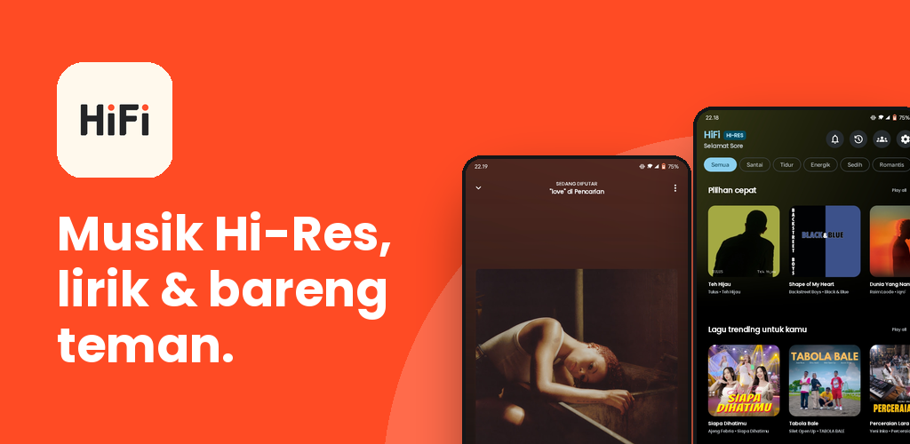
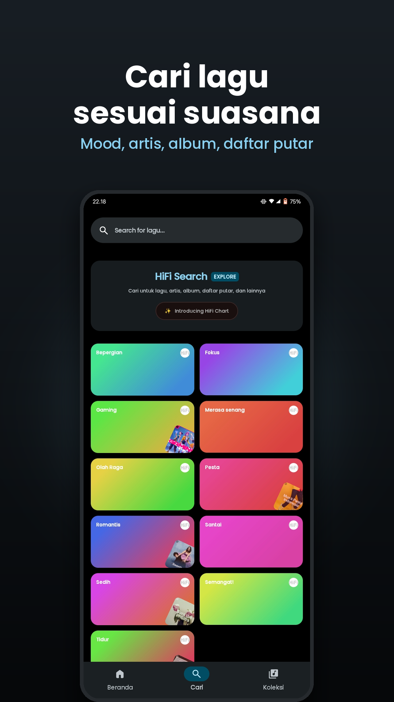
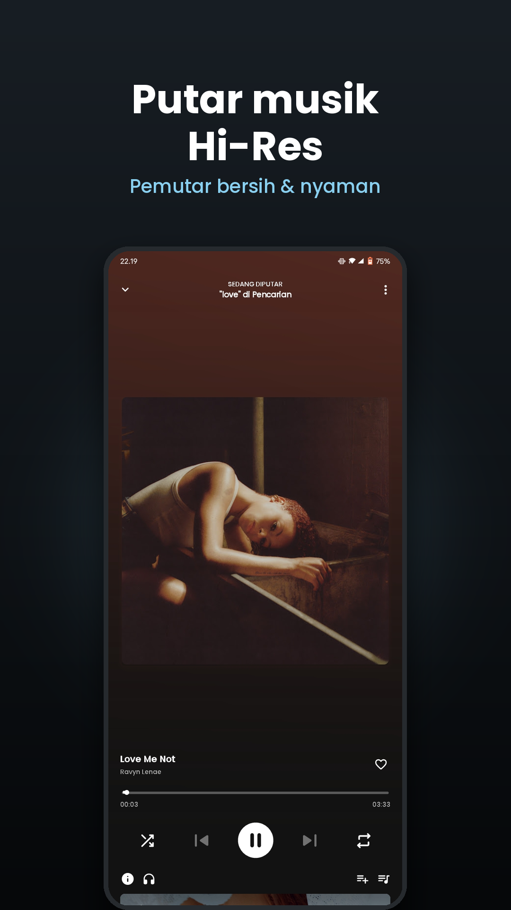
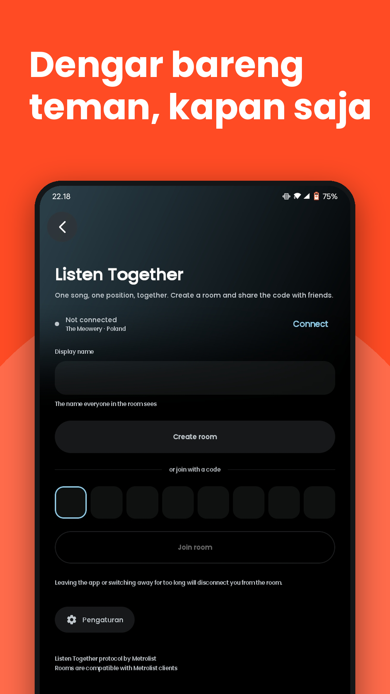
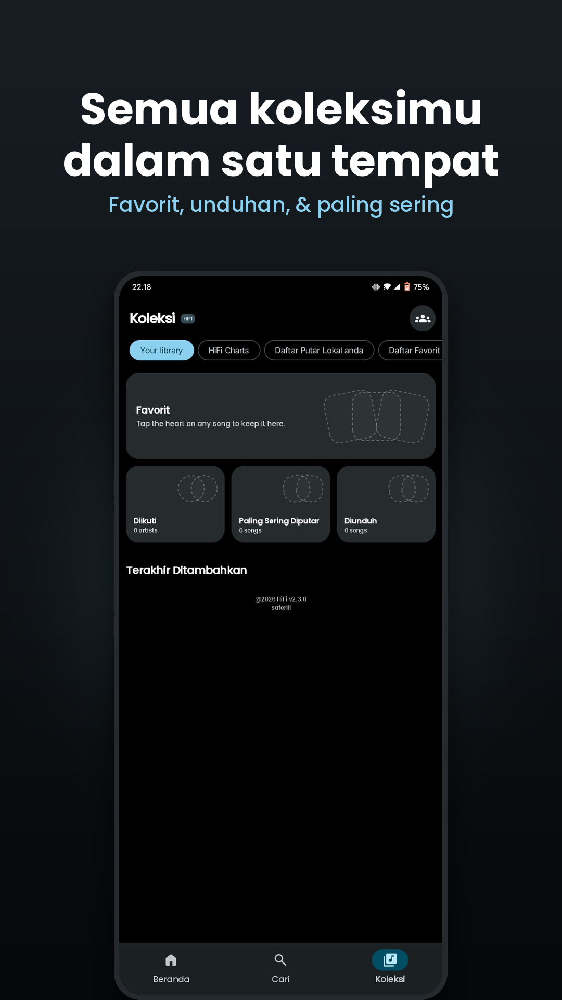
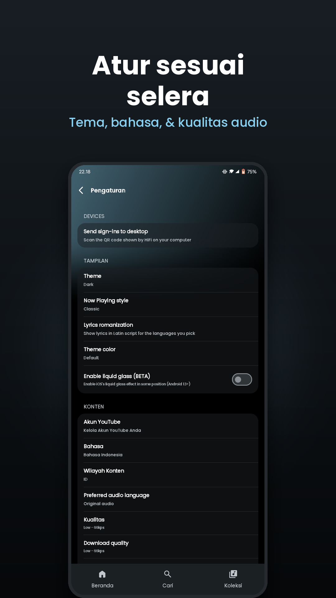

<p align="center">
  
</p>

<p align="center">
  
</p>

<h1 align="center">HiFi</h1>

<p align="center">
  Open-source, ad-free music streaming client and player built with Compose Multiplatform.
</p>

<p align="center">
  <a href="https://github.com/saferill/HiFi/releases/latest"></a>
  <a href="LICENSE"></a>
  <a href="https://kotlinlang.org"></a>
  <a href="https://www.jetbrains.com/lp/compose-multiplatform/"></a>
  <a href="https://syafril.pages.dev"></a>
</p>

---

HiFi is a lightweight music player and streaming client for Android and Windows. It connects directly to public music streaming sources to provide an ad-free listening experience with synchronized lyrics, offline audio caching, and a 10-band equalizer.

## Downloads

Official builds are available on the [Releases](https://github.com/saferill/HiFi/releases/latest) page.

| OS | Package | Arch | Details |
| :--- | :--- | :--- | :--- |
| **Windows** | [`HiFi-2.3.0-Setup.exe`](https://github.com/saferill/HiFi/releases/latest/download/HiFi-2.3.0-Setup.exe) | x64 | Inno Setup installer with Desktop & Start Menu shortcuts |
| **Android** | [`HiFi-arm64-v8a.apk`](https://github.com/saferill/HiFi/releases/latest/download/androidApp-arm64-v8a-release.apk) | ARM64 | Recommended for most modern Android devices |
| **Android** | [`HiFi-universal.apk`](https://github.com/saferill/HiFi/releases/latest/download/androidApp-universal-release.apk) | All | Universal package compatible with all Android devices |
| **Android** | [`HiFi-armeabi-v7a.apk`](https://github.com/saferill/HiFi/releases/latest/download/androidApp-armeabi-v7a-release.apk) | ARMv7 | Legacy 32-bit Android devices |
| **Android** | [`HiFi-x86_64.apk`](https://github.com/saferill/HiFi/releases/latest/download/androidApp-x86_64-release.apk) | x86_64 | Android emulators & ChromeOS |

## Screenshots

<p align="center">
  
  
  
  
</p>

<p align="center">
  
  
  
</p>

## Overview of Features

### Core Audio & Streaming
- Ad-free playback backed by YouTube Music data endpoints.
- Persistent background playback service with Android media notifications.
- Local audio caching for offline playback.
- Hardware-accelerated audio pipeline via Google AndroidX Media3 (Android) and libmpv (Desktop).
- 10-band equalizer with bass boost and custom presets.
- Spotify Canvas video background integration.

### Lyrics & Metadata
- Real-time synchronized lyrics from LRCLIB, Spotify, and YouTube transcripts.
- Multi-language lyrics translation.
- SponsorBlock integration to automatically skip non-music segments.
- Return YouTube Dislike integration.

### Library & Integration
- Top Charts, Moods, Genres, and Podcast directories.
- Custom local playlists and YouTube Music account synchronization.
- Android Auto support with voice search and queue controls.
- Configurable sleep timer.

### Privacy
- No third-party telemetry, trackers, or advertising SDKs.
- Direct network requests between client and streaming servers.

## Tech Stack

- **Language**: Kotlin 2.4
- **UI**: Compose Multiplatform (Jetpack Compose / Material 3 Expressive)
- **Audio Engine**: AndroidX Media3 (Android) / libmpv (Desktop)
- **Persistence**: AndroidX Room (bundled SQLite) + DataStore
- **Networking**: Ktor Client, OkHttp
- **DI**: Koin
- **Packaging**: AGP (Android) / Inno Setup & WiX (Windows)

## Project Structure

```text
HiFi/
├── androidApp/       # Android application module & platform services (Media3)
├── desktopApp/       # Windows desktop application module & entry point
├── composeApp/       # Shared Compose Multiplatform UI, screens & ViewModels
├── core/
│   ├── data/         # Repository implementations, caching & network clients
│   ├── domain/       # Business logic, use cases & domain models
│   ├── database/     # AndroidX Room SQLite database & DAOs
│   └── service/      # Audio playback engines & streaming scrapers
└── scripts/          # Packaging & build scripts (Inno Setup)
```

## Building

### Prerequisites
- JDK 21+
- Android SDK (API 36)
- Inno Setup 6 (Windows packaging)

### Build APK
```bash
./gradlew :androidApp:assembleRelease
```
Output: `androidApp/build/outputs/apk/release/`

### Build Windows Installer
```bash
# Generate unpacked application directory
./gradlew :desktopApp:packageAppImage

# Compile installer executable
iscc scripts/windows/HiFi-setup.iss
```
Output: `release_builds/windows/HiFi-2.3.0-Setup.exe`

## FAQ & Troubleshooting

<details>
<summary><b>Windows: "Windows protected your PC" during installation</b></summary>

Because HiFi is an independent open-source application and does not use an expensive commercial code-signing certificate, Windows SmartScreen may show a warning. Click **"More info"** and then select **"Run anyway"** to proceed with the installation.
</details>

<details>
<summary><b>Managing storage & cache size</b></summary>

HiFi caches streamed audio for responsive offline playback. You can customize the maximum cache limit or clear cached data at any time via **Settings > Storage & Cache**.
</details>

<details>
<summary><b>Updating HiFi</b></summary>

HiFi delivers updates directly via GitHub Releases. Navigate to **Settings > Check for update** to check and download new releases.
</details>

## Maintainer

**Syafril** — [syafril.pages.dev](https://syafril.pages.dev)  
Repository: [github.com/saferill/HiFi](https://github.com/saferill/HiFi)

## License

This project is licensed under the [GNU General Public License v3.0](LICENSE).
